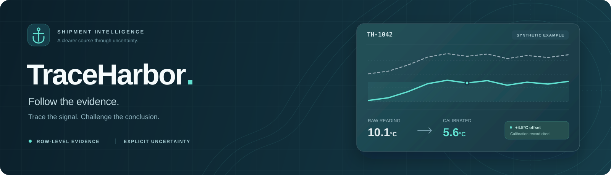
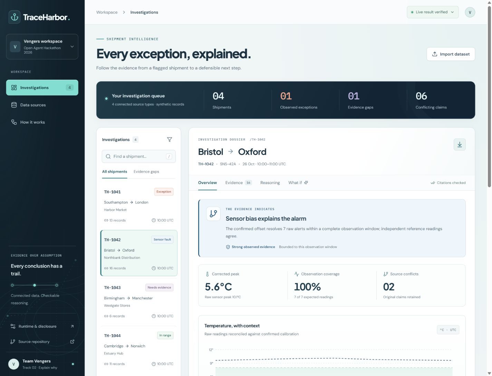
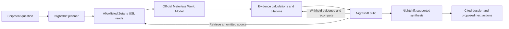

# TraceHarbor



**Turn a disputed temperature alert into an investigation you can inspect.**

[Explore the published demo](https://traceharbor.web.app) · [Watch the walkthrough](https://traceharbor.web.app/submission/traceharbor-demo.mp4) · [Read the deck](https://traceharbor.web.app/submission/traceharbor.pdf) · [Run locally](#run-the-sample) · [Documentation](docs/README.md)

An operations analyst receives a temperature alert, but the shipment status says everything is fine. The answer is spread across a manifest, logger readings, carrier notes and calibration records. TraceHarbor brings those records into one investigation, explains the supported conclusion, and shows what evidence could change it.

The useful output is a **cited handoff dossier**: what was observed, which claims conflict, which records support the explanation, what is missing, and what the operator should investigate next. The prototype uses synthetic shipments; its intended operational value has not yet been measured with customers.

Built by **Vengers** for the Open Agent Hackathon 2026, **The Agent That Can Explain Why**. The official hackathon entry remains **unsubmitted**; publication of this repository and website is separate from submission.

## Why this is useful

| The analyst’s question | What TraceHarbor does | Practical next step |
| --- | --- | --- |
| Did the logger observe an exception? | Checks valid, calibrated observations against the shipment’s stated range and window | Inspect the cited readings and reconcile contradictory status claims |
| Could the alarm come from the sensor? | Matches each reading to a valid confirmed calibration and checks independent reference observations | Review the certificate and request sensor maintenance where supported |
| Is the evidence complete enough? | Checks the expected primary-sensor schedule, missing observations and unresolved calibration | Request missing evidence instead of treating silence as clearance |
| Would this explanation survive scrutiny? | Withholds selected evidence and recomputes the conclusion | Identify which assumption or record the explanation depends on |

TraceHarbor supports an analyst’s investigation. It does not authorize cargo release, disposal or consumption, and it does not certify product safety. Fixture temperature limits are demonstration assumptions, not regulatory standards.

## A concrete example: the alarm changes meaning

For synthetic shipment **TH-1042**, the raw peak is **10.1°C** against a stated **2–8°C** range. Seven primary readings appear too warm. A confirmed calibration records a **+4.5°C observed-minus-reference offset**, making the corrected peak **5.6°C**; two independent reference observations agree.

| Evidence available | Computed conclusion | Why |
| --- | --- | --- |
| Manifest and telemetry | **Insufficient evidence** | The raw alarm alone does not establish the sensor’s validity |
| Critic retrieves incidents and calibration | **Sensor bias explains the alarm** | Applicable calibration and reference checks support the correction |
| Calibration deliberately withheld | **Insufficient evidence** | The supporting correction can no longer be justified |

This branch happened in the [current actual local live run](examples/live-agent/attempt-06-final-decimal/manifest.json). It is an evidence sensitivity check, not a prediction of a physical intervention. The numerical calculation and final outcome remain constrained by the evidence core.



*Actual local live investigation on synthetic records. [Open the full dossier capture](docs/images/final-live-investigation.png) or [inspect the matching execution receipt](examples/live-agent/attempt-06-final-decimal/manifest.json). The public website remains a browser-computed sample.*

## What you can inspect

- **Investigation dossier:** calibrated observations, schedule coverage, supported findings and proposed next actions.
- **Source evidence:** stable row IDs, original values, timestamps and calibration validity intervals behind each citation.
- **Conflicting claims:** original shipment and operator statuses stay visible when observations contradict them.
- **Evidence experiments:** withhold calibration or selected records and recompute; a missing observation stays missing.
- **Execution trace:** inspect the planner, governed source reads, critic branch, recomputation and supported synthesis.
- **Portable results:** export the dossier or run the same investigation programmatically from the CLI/API.

Four original scenarios cover an observed excursion, sensor bias, insufficient evidence and an in-range control. They are computed from records, not loaded from saved answer files. See the [product walkthrough](docs/product-guide.md) and [data contract](data/README.md).

## Public sample and local live execution

| Experience | Runs where | Evidence path | Model/database calls |
| --- | --- | --- | --- |
| **Published website** | Your browser on Firebase Hosting | Public synthetic feeds → deterministic evidence core | None |
| **Sample CLI** | Your machine | Synthetic feeds → official World Model → evidence core | No Zetaris or Nightshift calls |
| **Local live companion / CLI** | A configured machine | Actual Zetaris USL responses → official World Model → evidence core, with Nightshift planning and critique | Actual calls, retained in run receipts |

The public static site cannot reach the builder’s private local services. Live mode requires the documented local companion and configured services. A failed live run remains an error; it never silently substitutes a sample answer.

## How the agent works



The planner selects two or three initial sources; manifest and telemetry are required. The critic can retrieve omitted sources and choose a bounded withholding test. The writer selects existing supported findings and actions. Model choices affect the evidence available to the investigation; the deterministic core owns arithmetic, calibration rules, admissibility, outcomes and citation checks.

One live run is bounded to **three model calls, four unique source reads and five minutes**. The verified model route is **local Llama 3.2 1B Instruct through Meterless Nightshift**. No NVIDIA cloud, Nemotron or verified NVIDIA acceleration is claimed. [Architecture and contracts →](docs/architecture.md)

## Run the sample

Install **Node.js 22.11 or later** and npm. No model, GPU, service credentials or sponsor platform is needed for the sample.

```powershell
git clone https://github.com/madvidd/GenAI.works_Hackathon.git
Set-Location GenAI.works_Hackathon
npm.cmd ci
npm.cmd run dev
```

Open the local address printed by Vite. In another terminal, produce a dossier without opening the UI:

```powershell
npm.cmd run agent:sample -- --shipment TH-1042
```

The command writes a unique directory under `logs/runs/` containing `dossier.json`, `manifest.json`, `trace.jsonl`, `world-events.jsonl` and `world-audit.jsonl`. Sample manifests disclose zero model and SQL calls. On macOS/Linux, use `npm` in place of `npm.cmd`; the Windows spelling avoids PowerShell argument-forwarding problems.

```powershell
npm.cmd test
npm.cmd run build
npm.cmd run preview
```

For structured input files, API requests, local live setup, common errors and verification commands, follow [Getting started](docs/getting-started.md). The four [example inputs and outputs](examples/README.md) make the behavior easy to inspect.

## Run with real local services

1. Configure an actual Zetaris instance and private API credentials.
2. Publish the four synthetic feeds, review the SQL plan, then register sources, activate the USL and run the quality rule using the supplied setup script.
3. Install Nightshift, configure its local inference lane, and select the actual model ID returned by the runtime.
4. Keep service tokens in ignored `.env.local`; build the UI and run the loopback companion with `npm.cmd start`.
5. Run an investigation from `http://127.0.0.1:8787` or `npm.cmd run agent:live -- --shipment TH-1042`, then inspect its actual query/model receipts.

The [live setup guide](docs/getting-started.md#run-the-local-live-companion) includes exact environment variables and commands. [SQL setup](sql/README.md) documents mutations and request payloads; [local-model setup](docs/local-model-setup.md) records the working Nightshift 1.2.7 lane configuration and resource-admission checks. Installing services and downloading a model are separate setup steps; the agent does not install dependencies during a run.

## Evidence, with its scope

The current evidence core is **1.0.2** with **33 passing local tests** and four regenerated sample outputs. The redesigned interface has [actual browser checks](docs/ui-validation.json), and both final cases have [completed live investigations](docs/live-revision-validation.json) on the same 1.0.2 core. TH-1042 resolves to sensor bias; TH-1043 retains insufficient evidence. Each actual run made three Nightshift calls and four Zetaris reads. These two synthetic cases establish their recorded behavior, not broad reliability. Final publication and a clean-clone check of the intended pushed revision remain separate release gates.

The published baseline was verified on **27 October 2026** at commit [`ca1f6b7`](https://github.com/madvidd/GenAI.works_Hackathon/commit/ca1f6b7723b86319d31f0a824c67d8ba1ea36daa). These receipts describe that revision and its archived runs; subsequent changes require their own validation.

| Check | Observed result | Inspect the proof |
| --- | --- | --- |
| Current local regressions | 33 tests passed; duplicate identities/timestamps, unrounded thresholds, empty-evidence review and workspace validation covered | [Current readiness review](docs/readiness-review.md) |
| Current browser and live runs | Redesigned UI exercised; TH-1042 sensor bias and TH-1043 abstention; downloaded exports match server dossiers | [UI checks](docs/ui-validation.json) · [Actual live runs](docs/live-revision-validation.json) |
| Baseline clean clone | Fresh dependency installation, 16 passing tests, production build, three sample CLI cases with no credentials or sponsor calls | [Clean-clone receipt](docs/clean-clone-validation.json) |
| Actual live CLI investigation | 3 local Nightshift calls, 4 Zetaris reads, 46 World Model records; completed in 142.323 seconds | [Run archive](examples/live-agent/attempt-02/) · [Validation](docs/live-agent-validation.json) |
| Actual live browser investigation | Export matched the server dossier; critic retrieval and withholding changed the outcome as described above | [Browser run](examples/live-agent/attempt-03-browser/) · [UI checks](submission/browser-qa/validation.json) |
| Zetaris | 34 setup statements; 12 exploration queries; USL activation; DQ found 26 rows, 25 valid and 1 invalid | [SQL receipts](examples/live-zetaris/) |
| World Model | 46 ingested records; 46 unchanged records skipped on warm reload; separate upstream conformance run passed 8/8 | [Feature test](tests/runtime.test.mjs) · [Integration explanation](docs/sponsor-technology.md) |
| Published artifacts | Unauthenticated downloads matched the verified build, including feeds, video, PDF, PPTX and captions | [Deployment receipt](docs/deployment-validation.json) |

Automated orchestration tests use mocked transports; actual service runs are archived separately. Earlier failures remain visible, including a timed-out live attempt and a preflight that responded but did not follow its instruction. See the [evidence guide](docs/evidence-guide.md).

## Limits and next validation

This is a working prototype with small, synthetic datasets. Discrete observations do not establish continuous temperature, exact exposure duration or causation. Evidence strength is a transparent heuristic, not a calibrated probability. The four feeds represent separate operational systems on one host; production federation, access control and scale have not been demonstrated.

The next useful test is an analyst study on identical case files: compare active investigation time, finding correctness, citation validity, missed evidence and required human corrections. Report cold setup separately from repeat-use time, and retain failed attempts. We have no measured productivity gain, customer deployment or commercial ROI. [Evaluation plan →](docs/evaluation.md)

## Repository guide

| Area | Purpose |
| --- | --- |
| [`src/`](src/) | React interface and browser interactions |
| [`core/`](core/) | Evidence logic, response-size limits and the vendored World Model |
| [`server/`](server/) | Programmatic agent, model client, graph-context integration and local companion API |
| [`data/`](data/) · [`sql/`](sql/) | Original synthetic feeds and repeatable Zetaris setup |
| [`examples/`](examples/) | Current 1.0.2 sample results and separately dated actual live receipts |
| [`tests/`](tests/) | Evidence-rule, provenance and orchestration checks |
| [`docs/`](docs/README.md) | Product, setup, architecture, evaluation and hackathon evidence |
| [`submission/`](submission/README.md) | Narrated video, captions, editable deck and reproducible artifact sources |

## Attribution and project status

Project-authored code and fixtures use the existing [MIT license](LICENSE), copyright 2026 Seyed Mohammad Salehi. The official Meterless World Model is vendored at revision `1742dec56a66e58eef9dda2d2b865823758ca8cd` with its Apache-2.0 license and notices. Other dependencies retain their own licenses. OpenAI Codex assisted implementation; Cursor use is not claimed. [Sponsor roles and attribution →](docs/sponsor-technology.md)

The hackathon deadline is **27 October 2026, 23:45 UTC**. Contributor roles and primary contact still require team confirmation, and no platform submission confirmation has been recorded. The [requirements matrix](docs/requirements-matrix.md), [resource-review ledger](docs/resource-review-ledger.md) and [submission checklist](docs/submission-checklist.md) preserve the evidence and remaining gates.
