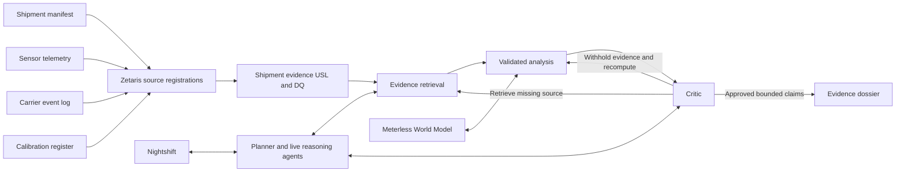

# TraceHarbor architecture

Status: implementation contract, 27 October 2026. The deterministic core, live orchestration, and Zetaris plan are present. The local 14-test suite passed, including the actual World Model feature. Network orchestration tests use mocks; real sponsor execution remains unverified.

## Problem boundary

An operations analyst has a disputed temperature alert. A manifest says the shipment is clear, the logger shows a spike, a carrier note describes a door event, and calibration may change the meaning of a reading. TraceHarbor investigates one bounded observation window and returns an explanation, contradictions, missing evidence, and proposed next actions for a human operator.

A door event near an excursion is an association, not experimental proof of causation. An observation gap remains unknown. A sensor correction requires a confirmed certificate valid at the observation time. The system does not certify product safety or execute a physical action.

## Execution modes

| Mode | Data and reasoning | What it demonstrates |
| --- | --- | --- |
| Browser demonstration | Public synthetic feeds and input-dependent deterministic computation | Interactive evidence inspection and calculations |
| Sample runner | Fixture inputs and executable local logic with no external credentials | Programmatic behavior and explicitly disclosed sample traces |
| Live runner | Zetaris USL evidence, Meterless World Model feature, and actual models through Nightshift | Sponsor integration only when actual receipts and tests exist |

Never label the first two modes as live model or database execution. Live failures remain visible. An explicitly selected sample rerun is a separate run with its own mode, ID, and provenance.

## Implemented live data flow



This diagram describes the code. It is not a real-service execution receipt.

## Decisions and authority

| Role | Decision owned | Required run evidence |
| --- | --- | --- |
| Planner | Bound the shipment/window and choose evidence to retrieve | Request, plan, handoff, actual model receipt in live mode |
| Retriever / data steward | Retrieve and validate evidence without losing original rows | SQL, row results/counts, rejected records and reasons |
| Analyst | Calculate calibrated observations, schedule coverage, and supported hypotheses | Inputs, calculations, and source IDs |
| Critic | Retrieve missing evidence and choose a bounded evidence-withholding recheck; preserve unsupported conclusions as unresolved | Actual extra query, provisional/final outcome, challenge, selected intervention, recomputed result |
| Dossier writer | Communicate only approved claims with citations and limits | Current generated result linked to the request and trace |

Names alone are insufficient. The critic must change what can be concluded. Preserve initial and revised interpretations so a judge can see why the answer changed. Record the returned model ID rather than infer it from a configured alias.

The planner chooses two or three initial sources, with manifest and telemetry required. The critic sees the provisional result and unfetched source list, can request missing sources, and causes actual allowlisted SQL reads. Returned rows are re-ingested into the official World Model before factual analysis is recomputed. In the mocked transport test, retrieving calibration changes insufficient evidence to a sensor-bias explanation; declining that retrieval leaves the case unresolved. The manifest records `initialSources`, `criticSources`, `provisionalOutcome`, `finalOutcome`, and `remainingMissingSources`. This test proves the code branch, not a live sponsor execution.

## Deterministic evidence contract

`core/investigator.mjs` exports `investigateShipment(feeds, shipmentId, options)`. `excludeRowIds` withholds evidence; `ignoreCalibration` withholds correction. These are sensitivity checks on the available record, not predictions of an intervention in the real world.

The core requires one manifest and unique evidence IDs, bounds the window, rejects malformed or impossible observations, and applies exactly one confirmed calibration in `[valid_from, valid_to)`. Pending, expired, and overlapping certificates stay unresolved. It counts primary-sensor schedule coverage and checks gaps. Reference probes corroborate observations but cannot fill primary-sensor gaps.

Original reported statuses remain visible when contradicted. Every citation must resolve to a retained row. Results are an observed excursion, sensor-bias explanation, insufficient evidence, or a bounded in-range finding. Confidence is a disclosed heuristic, not model accuracy, a safety probability, or a causal likelihood.

## Meterless boundary

The World Model feature uses the official engine implementation and preserves its Apache-2.0 license/notices. Upstream reference revision: `1742dec56a66e58eef9dda2d2b865823758ca8cd`. The local feature test passed: 46 source rows were ingested; a warm reload skipped all 46 unchanged rows with no new ingest events; four distinct shipment identities remained separate. External keys prevent fuzzy-name matching from merging similar shipment IDs. The investigator consumes evidence reconstructed from the graph. The official upstream conformance runner was executed separately and passed 8/8.

## Zetaris boundary

The numbered SQL files cover separately registered feeds, three exploratory queries per source, a four-table USL, activation mappings, integrity-rule execution, and three USL investigation queries. These are four synthetic operational datasets on one host, not four production providers.

USL joins preserve row IDs. A one-to-many event join must not inflate observation counts. The core reasons from original rows and distinct schedule positions. The REST adapter sends one SQL block per request, with the real bearer token, organization ID, fresh request UUID, and documented `queryId/sql/source/limit` body. It rejects unexpected response shapes and redacts tokens from errors.

## Hosting and API

The React/Vite site serves public assets and synthetic data. It embeds no provider token. Its live integration contract is:

```http
POST /api/investigate
Content-Type: application/json

{"shipmentId":"TH-1041","mode":"live"}
```

The successful envelope is `{ "result": <investigation result> }`. `npm start` serves the built UI and API at `http://127.0.0.1:8787`, with a loopback host/origin check, one active run, and a three-run/ten-minute budget. A static Firebase deployment does not provide this API or reach the developer's localhost. Keep the hosted live control unavailable or return a clear service error when the backend is absent. Public backend deployment is not claimed.

## Runtime controls and evidence

External requests, retries, critique rounds, and the overall run need explicit bounds. Incident prose is untrusted evidence, never executable instructions. Calculations and citation validation must remain independent of source-note commands.

Before claiming the full architecture works, retain: clean-clone sample execution with no credentials/services; changed-input results; actual live critique/retrieval branching; passing World Model tests; Zetaris source/USL/DQ receipts; a Nightshift completion with returned model ID; and browser/export/deployment checks. Selected published artifacts must be redacted. Missing evidence and partial failures stay visible.
